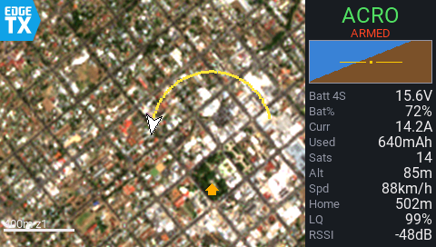

# EdgeTX widgets by New View Drone Solutions

Lua widgets for EdgeTX colour-screen radios, made by **NVFPV** (New View Drone Solutions).

| | |
|---|---|
| Website | https://www.newviewdronesolutions.com/ |
| YouTube | [@newviewfpv](https://youtube.com/@newviewfpv) |
| Contact | newviewdronesolutions@gmail.com |

---

## New View Telemetry (V2.1)

A full-screen widget with a **moving offline satellite map** on the left (your craft, its trail and home) and a **live flight panel** on the right: flight mode, armed state, artificial horizon, battery voltage and cells, battery %, current, mAh used, satellites, altitude, speed, distance home, link quality and RSSI. The map tiles live on the radio's SD card, so it works in the field with no internet.

- Map cursor: arrow, drone or plane, pointing where the nose points
- Home marker and a trail of the last part of the flight; home resets from a switch
- Zoom from a switch, the scroll wheel or the +/- keys, with a scale bar
- Warning limits you set yourself (altitude, distance, cell voltage, battery %, link quality, satellites): amber near a limit, red past it, with an optional beep
- Works on every colour screen size: 320x240, 480x272, 480x320, 800x480 and 320x480

> **Tester build.** V2.1 is in testing. Please use the tester feedback form included in the download.

### Which edition do I need?

| Edition | Use it with | Folder |
|---|---|---|
| **V2.1 ELRS & CRSF New View Telemetry** | ExpressLRS or TBS Crossfire, e.g. Betaflight with a GPS | [`new-view-telemetry/v2.1-elrs-crsf`](new-view-telemetry/v2.1-elrs-crsf) |
| **V2.1 MAVLink and mLRS New View Telemetry** | ArduPilot (MAVLink) or INAV over **mLRS** in CRSF mode. Also works with ExpressLRS / Crossfire. | [`new-view-telemetry/v2.1-mavlink-mlrs`](new-view-telemetry/v2.1-mavlink-mlrs) |

### Download

Get the full package from the **[Releases page](https://github.com/New-View-Drone-Solutions/edgetx-widgets/releases)**. Each zip has everything: the widget, user guide, step-by-step instructions, PC tools for making map tiles (including GMapCatcher) and the video tutorial.

The folders in this repository hold the same files except GMapCatcher and the video, which are only in the release zips.

### You need

- An EdgeTX radio with a colour screen on **EdgeTX 2.11 or later** (HelloRadioSky V15 needs 2.12 or later)
- Telemetry with GPS reaching the radio as CRSF sensors (see the editions above)
- A Windows PC to make map tiles (the tile maker also runs on Mac and Linux with Python)

### Quick install

1. Copy the `WIDGETS` and `IMAGES` folders from `SD card` onto the root of the radio's SD card and let them merge.
2. Make map tiles for your flying area with a tool in `PC tools` and copy them into `/IMAGES/NewView/sat_tiles/`. No map tiles are included.
3. On the radio, with the craft powered: **Model > Telemetry > Discover new sensors**.
4. Add a screen with the 1x1 layout (App mode for full screen), choose the widget **New View Telemetry**, then set Zoom, Min/Max zoom, Home reset, Cursor and your limits in Widget settings.

Full instructions with pictures are in `New View Telemetry - User Guide.pdf` and `INSTRUCTIONS - STEP BY STEP.txt`. MAVLink and mLRS users: also read `MLRS AND MAVLINK SETUP.txt`.

---

## Licence and credits

- **New View Telemetry** (widget, load screen, tile maker, guides, screenshots and video) © 2026 New View Drone Solutions (NVFPV), licensed under **[CC BY-NC 4.0](https://creativecommons.org/licenses/by-nc/4.0/)**: you may share and adapt it for non-commercial use, with credit. See [LICENSE.md](LICENSE.md). For commercial use, contact newviewdronesolutions@gmail.com.
- **GMapCatcher**, included in the release zips, is **not** made by NVFPV. It is © 2008 the GMapCatcher team and free software under the **GNU GPL version 2**. The copy included is the 100x100 tile fork by Alessandro Apostoli ([yaapu/gmapcatcher](https://github.com/yaapu/gmapcatcher)); the original project is [heldersepu/GMapCatcher](https://github.com/heldersepu/GMapCatcher). Its licence files and source links are kept with it in `PC tools/GMapCatcher`.
- Map imagery made by the tile maker contains modified Copernicus Sentinel data. Tiles downloaded with GMapCatcher follow each map provider's terms of use.

Fly safely and follow your local drone rules. New View Telemetry is a helper, not a replacement for keeping your aircraft in sight where the law requires it.
